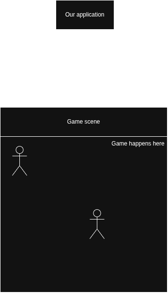
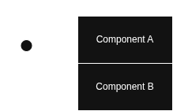
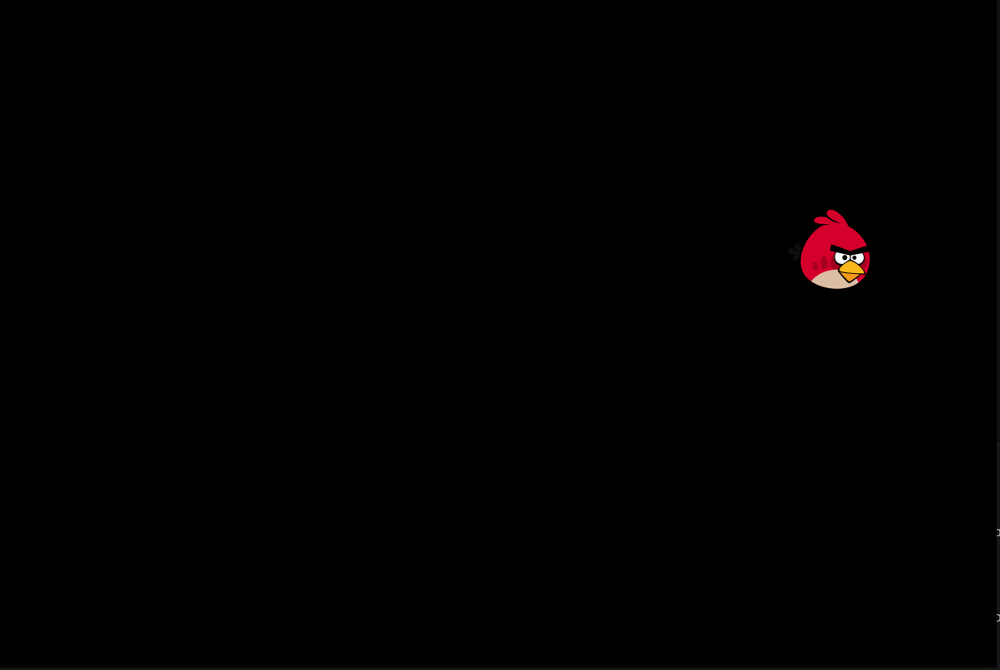

# Moss's Python Engine

A utility engine for making games in pygame, leveraging on the benefits of Composition as a design pattern.

## Contents
- [Quickstart](#quickstart)
- Lifecycle
- Components
- Rendering
- Physics


# Quickstart

- [Your Application](#new-application)
- [Game Scenes](#game-scenes)
- [GameObjects and Components](#gameobjects-and-components)
- [Rendering sprites](#rendering-sprites)
- [Moving our sprite](#moving-our-sprite)
- [Final source code]
- [Additional Info]

### New Application
_This should help you quickly start and understand how to use the engine, we will make a character move around!_

To start, create a new Application class, make sure it overrides the ```start()``` function

```python
# myapplication.py

from core.application import Application

class MyApplication(Application):
    
    def start():
        # We have yet to implement anything here yet
        return
```


This will be what runs our main program, but we need to make sure we use this application in our script. Let's head over to ```main.py```
```python
# main.py

import sys
import pygame
from core.application import Application

pygame.init()
my_app = Application()
my_app.start()
my_app.run()
sys.exit()
```


This will be how our application runs, but notice that it's running the default Application class

```python
my_app = Application()
```

Make sure to change this to your own Application class

```python
# myapplication.py

# Make sure the import path is correct
from rainier.myapplication import MyApplication

# my app = Application() <- REPLACE this line with MyApplication (see below)
my app = MyApplication()

```

Try running ```main.py``` now, you should see a black screen window with start with pygame. Congrats on completing step 1!

---

### Game Scenes

Our application runs, but we don't actually have anything happening, lets add a scene where we can start creating our custom game logic

#### What are scenes?
Scenes are like a mini-world where our game logic runs. We can swap them out at any time very cleanly, making it extremely convenient to load and unload our game scenes whenever we wish.



#### How do we make a scene?
Start by creating your custom scene class, the scene class should inherit from the base scene class, as well as it's ```on_load()``` function

```python
# myscene.py

from core.scene import Scene

class MyScene(Scene):
    # Use the base constructor for the scene class
    def __init__(self, name):
        super().__init__(name)

    def on_load(self):
        # Your scene object logic should run here!
        return
```


We have our scene now, but it isn't loaded in the game. Head back into ```myapplication.py``` (from before)

```python
# myapplication.py

from core.application import Application

class MyApplication(Application):
    
    def start():
        # This is where we load our scenes
        return
```

We can now load our scene here, first import the scene manager class and your custom scene at the top of the application file

```python
from core.scenemanager import SceneManager
from rainier.myscene import MyScene
```

```SceneManager``` is a utility class that helps us with loading and switching our scenes. We can load our custom scene with the ```SceneManager```

```python
def start():
    my_scene = MyScene("Rainier's scene") # Create our custom scene object
    SceneManager.load(my_scene) # Load our scene into the game


    print(SceneManager.get_scenes()) 
    # For debugging, output the scenes, you should see your scene appear in the logs under Loading...
    return
```

We have now loaded our scene! If your print statement seems to fail, please inform your nearest NS buddy (js call me)


---


### GameObjects and Components

Our game scene works, but it doesn't actually do anything yet either. This is where ```GameObjects``` and ```Components``` come into play.

#### What are GameObjects & Components

GameObjects are like the individual characters of a world. 
Components are the brains/logic for what a GameObject should do, a GameObject can have multiple components




Let's add a GameObject to the world


```python
# myscene.py

from core.gameobject import GameObject # IMPORT the files

from core.scene import Scene

class MyScene(Scene):
    # Use the base constructor for the scene class
    def __init__(self, name):
        super().__init__(name)

    def on_load(self):
        my_gameObject = GameObject() # Add a new GameObject when loading your scene
        return
```


By itself, our gameObject doesn't do anything, this is where components come in.
GameObjects themselves contain components within them, we can dynamically add them into our GameObject


#### Creating your first component

To create your first component, derive from the Component class

```python
# mycomponent.py

from core.component import Component

class MyComponent(Component):
    def __init__(self, enabled=True):
        super().__init__(enabled)
```

Components can execute various functions at set points in the game loop. Here is a list of all the functions that you can override from the base component class.

```python
start(self, params=None) # -> Runs when the component is created
update(self, params=None) # -> Runs once per game frame 
late_update(self, params=None) # -> Runs once per game frame (AFTER every component has ran update())
physics_update(self, params=None) # -> Runs once per fixed interval
before_render(self, params=None) # -> Runs before the game renders all the sprites
after_render(self, params=None) # -> Runs after the game renders all sprites

on_collision_enter(self, collision_data) # Runs on the frame that 2 objects collide with one another
on_collision_exit(self, collision_data) # Runs on the frame that 2 objects stop colliding with one another
```

As an example, we'll do a simple print statement, let's print for ```start()```, ```update()``` and ```late_update()```

```python
# mycomponent.py

from core.component import Component

class MyComponent(Component):
    def __init__(self, enabled=True):
        super().__init__(enabled)

    def start(self, params=None):
        print("Start!")

    def update(self, params=None):
        print("Update")

    def late_update(self, params=None):
        print("Late update")
```


#### Bringing it all together

First import your component into the scene.

```python
# myscene.py

from core.gameobject import GameObject
from rainier.mycomponent import MyComponent  # IMPORT the files

from core.scene import Scene

class MyScene(Scene):
    # ...
```


GameObjects have a function called ```add_component```, where we can add a component directly into them

```python
# myscene.py


def on_load(self):
    my_gameObject = GameObject()
    my_gameObject.add_component(MyComponent()) # Add our component here! 
    return
```

Try running ```main.py``` again! You should see the output log showing all the print statements

    Update
    Late update
    Update
    Late update
    Update
    Late update
    Update
    Late update
    Update
    Late update


Congrats! You have added your first component!

---

### Rendering Sprites

Now, our scene looks a little bland, with our previous knowledge of components, let's add a sprite to our GameObject.


#### SpriteRenderer component

In your scene, import the sprite renderer component, we will need this to render our scene

```python
# myscene.py

from core.gameobject import GameObject
from rainier.mycomponent import MyComponent
from components.spriterenderer import SpriteRenderer # IMPORT the sprite renderer

from core.scene import Scene

class MyScene(Scene):
    # ...
```


To define a sprite, add in the asset name. The asset folder directory is already pre-appened to the front for you.

```python
# myscene.py


def on_load(self):
    my_gameObject = GameObject()
    my_gameObject.add_component(SpriteRenderer("Red.png")) # Use Sprite Renderer instead!
    # The sprite renderer automatically assumes we're using the assets folder

    return
```

We need to set the scale of our object too, or the sprite will be too small to see, this is where the Transform component comes in


#### Transform Component

Transform defines a position, rotation and scale for the gameObject. It is automatically included in EVERY gameObject by default.

Let's reposition and scale up our sprite.

```python
# myscene.py


def on_load(self):
    my_gameObject = GameObject()
    my_gameObject.add_component(SpriteRenderer("Red.png")) # Use Sprite Renderer instead!
    # The sprite renderer automatically assumes we're using the assets folder

    my_go.transform.position.x = 1000
    my_go.transform.position.y = 300
    my_go.transform.scale.x = 100
    my_go.transform.scale.y = 100
```

Try running your script now. You should see the red bird!




---

### Moving our sprite

Now, our red bird is just standing there. Let's make it move!

We can create a new component specifically for this. Let's call it ```MoveComponent```.
Our movement should have a speed, let's add that too!

```python
# movecomponent.py

from core.component import Component

from components.transform import Transform
from utility.vec2 import Vec2
from core.time import Time # This is important too

class MoveComponent(Component):
    def __init__(self, speed, enabled=True):
        super().__init__(enabled)
        self.speed = speed # Movement speed

    def start(self, params=None):
        return

    def update(self, params=None):
        return
```

To make the sprite appear to move, we need to update it's position. This can be done by adjusting the bird's ```Transform```. We need to move the bird every frame, so we use update.

Let's move it horizontally.


```python
# movecomponent.py

def update(self, params=None):
    attached_gameobject = self.game_object # -> This gets us the game object that contains this component
    gameobjects_transform = attached_gameobject.transform # -> The game object has a transform component

    position = gameobjects_transform.position # -> The position of the game object now

    position.x += self.speed * Time.get_deltatime() # Move our character based on the speed value
    # Multiplying the speed by delta time ensures the character moves consistently regardless of frame rate
    return
```


Try adding this script to your gameObject now

```python
# myscene.py

from core.gameobject import GameObject
from rainier.mycomponent import MyComponent
from components.spriterenderer import SpriteRenderer # IMPORT the sprite renderer
from rainier.mycomponent import MoveComponent # IMPORT the movement component

from core.scene import Scene

class MyScene(Scene):
    # Use the base constructor for the scene class
    def __init__(self, name):
        super().__init__(name)

    def on_load(self):
        my_gameObject = GameObject()
        my_gameObject.add_component(SpriteRenderer("Red.png")) # Use Sprite Renderer instead!
        # The sprite renderer automatically assumes we're using the assets folder

        my_go.transform.position.x = 1000
        my_go.transform.position.y = 300
        my_go.transform.scale.x = 100
        my_go.transform.scale.y = 100


        my_go.add_component(MoveComponent(50)) # Add the movement component and define the speed
```


The bird should move now! Give it a try :D